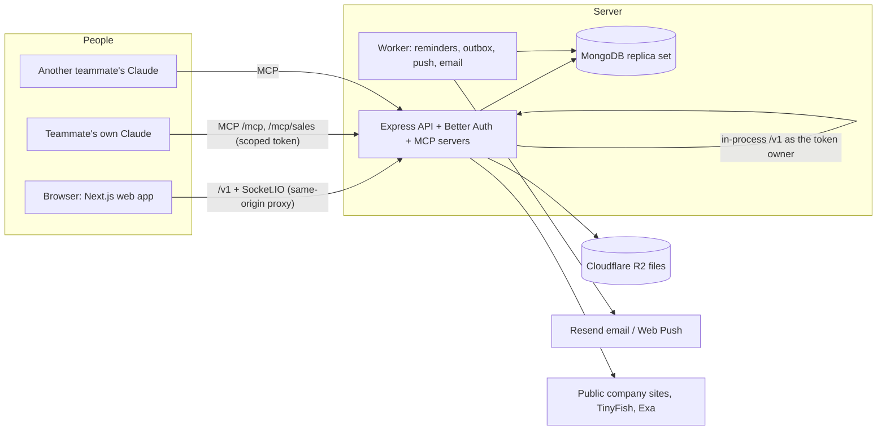

# Venture Studio OS (Venture OS)

**One shared memory for a team's AI, and the work it runs.**
Team Buildory · AlgoStorm 2.0 · Version 0.2.0

Small teams now run their businesses through AI, but every person's AI knows a different version of the business. Venture OS is a self-hosted team workspace that is also an MCP server: each venture's knowledge, skills, decisions and tasks live in one place, and **each teammate's own Claude reads and acts on them live, with that person's permissions**. Claude does the work; people make the decisions.

- **Problem statement:** [PROBLEM_STATEMENT.md](PROBLEM_STATEMENT.md)
- **Live deployment:** https://os.buildory.dev (sign-in by invitation)
- **Setup and operations guide:** [docs/setup-and-operations.md](docs/setup-and-operations.md)

---

## The problem (short)

We are four people running three businesses, almost entirely through Claude. Each of us had separate chats, so each person's AI held a different picture of the business: the same question got different answers, know-how lived in one head, and our fix (Markdown instruction files shared through Git) went stale with every change and could not assign or check work. The problem is **context, not intelligence**. It affects any small team running more than one thing with AI, and any single business once two people use AI. Full statement, evidence and alternatives: [PROBLEM_STATEMENT.md](PROBLEM_STATEMENT.md).

## The solution

| Layer | What it does |
|---|---|
| **Team workspace** | `Workspace → Ventures → Groups → Channels`, with tasks, evidence review, reminders, calendar, knowledge documents, decisions, requests, classes, direct messages, notifications and leaderboards |
| **Venture memory for AI** | Per-venture Markdown context plus workspace context, and team "skills" (how we do each kind of work), written by admins and venture heads and read by Claude before it works |
| **Venture Studio connector** (`/mcp`) | 46 MCP tools so each person's Claude can read the venture, plan the day, create and assign tasks, review evidence, write knowledge, post messages and set reminders as that person |
| **Dealflow Sales connector** (`/mcp/sales`) | 31 MCP tools for proof-backed sales: find and judge leads against an approved offer, draft messages, review drafts in a separate session, log replies and calls, daily and weekly reports |
| **Control** | Five roles, per-venture access, approvals that only people can give, audit log of every write, nothing sent automatically |

## How AI is used (and how it is not)

- **The server makes no LLM API calls.** There is no Anthropic, OpenAI or other model SDK in the code or lockfile. All reasoning is done by **each person's own Claude** (their own subscription), connected through the **Model Context Protocol**.
- **Claude reads the team's memory, not copies of it.** The connector's instructions make Claude ask which venture it is working on and read that venture's whole context first (`read_venture_context`); tools keep reminding it until it has. Context and skills are treated as guidance on how to work, never as authority to override the user, cross ventures or change data.
- **Claude acts only as the signed-in person.** Every tool calls the product's own `/v1` API in-process as the token's owner, through an allowlist of routes, so the same permission checks apply as in the web app (`apps/api/src/mcp/http.ts`, `apps/api/src/internal-auth.ts`).
- **Untrusted text stays data.** Web pages, messages and documents returned to Claude are cleaned of hidden control characters and marked as untrusted (`apps/api/src/mcp/format.ts`).
- **Prompts as slash commands:** `today`, `standup`, `triage` (workspace) and `sales`, `review_drafts`, `find_leads`, `todays_calls`, `weekly_review`, `daybreak` (sales).
- **MCP Apps cards:** nine sales tools return an interactive card (`ui://dealflow-sales/card.html`) for clients that render MCP Apps.

### Example: one line in, real work out

> "Give Ashutosh the pricing page, due Friday."

Claude finds the person (`find_person`), creates the task with an outcome, a definition of done and the evidence required (`create_task`), and a `task_start` reminder repeats until the work starts. When Ashutosh adds proof (`add_evidence`), it waits for review (`review_evidence`); the task can only be marked done once evidence is accepted. Messages Claude posts are labelled "via Claude".

## Features in this repository

### Team workspace (web app + API)
- **Ventures, groups and channels** with realtime messaging (Socket.IO), mentions and per-channel notification choices; **direct messages**.
- **Tasks** with outcomes, definition of done, priorities, estimates, blockers, comments, Kanban board and focus sessions. **Done requires accepted evidence** (or a reviewed exception); nobody reviews their own work (`apps/api/src/routes/work.ts`).
- **Reminders**: a start reminder that repeats every 10 minutes until a task starts, a deadline warning when the estimate exceeds the time left, personal reminders and snooze (`packages/core/src/reminders.ts`, `apps/worker`).
- **Calendar**: private, venture and group events, repeats, RSVP, reminders, and a read-only ICS feed for phone calendars, opened by a hashed secret (`apps/api/src/routes/calendar*.ts`).
- **Knowledge**: Markdown documents with versions, approval, suggested changes checked against a base version, and sensitivity filtering; PDF and Word text extraction in a sandboxed child process (`apps/api/src/routes/knowledge.ts`, `apps/api/src/file-text.ts`).
- **Decisions**, **requests for information**, **classes** (apply what you learned, get it reviewed) and a **leaderboard** (70% on-time, 30% evidence accepted first time).
- **Search**: MongoDB full-text search over knowledge chunks (split by heading), tasks, messages and file text.
- **Files**: Cloudflare R2 with short-lived signed URLs, staging then an immutable final key, 25 MB limit and a content-type allowlist.
- **Notifications** through a transactional outbox: in-app, Web Push (VAPID) and opt-in email (Resend); retries with backoff.
- **Channel commands** `/assign` and `/notify` with a typed preview before they run.
- **People and access**: invitations, five roles (`admin`, `venture_head`, `contributor`, `reviewer`, `learner`), venture archive/restore with a recovery copy, one-time first-admin setup.
- **Connect Claude** page: create scoped, expiring personal access tokens with presets.

### Sales (Dealflow)
- **Pipeline** of 15 stages from `identified` to `retained_referred`, with CSV import/export, bulk actions and saved views.
- **Offers**: versioned packets (gates, signals, claims to avoid, message rules, price boundary) that a venture head approves.
- **Verdicts with proof**: recommend, hold or reject; every evidence item is a claim plus a **verbatim quote and URL** (1–20 per verdict), with a required case *against*. Only a person can override a verdict.
- **Drafts and separate review**: a draft written by Claude must be reviewed in a different Claude session started in review mode; a person approves.
- **Nobody is messaged by the app.** Marking a draft sent only records a manual send; automatic sending returns `503 INTEGRATION_UNAVAILABLE` (`apps/api/src/routes/sales-drafts.ts`).
- **Built-in lead finder** that reads public company websites, with company search through TinyFish Search and Exa; extraction is deterministic (no LLM).
- **Plays** (campaigns with hypothesis and stop rule), shared sales notes ("brain"), workspace-wide **do-not-contact list**, per-venture daily caps and WhatsApp opt-in records.
- **Daybreak** (morning work list) and **weekly report** with calibration; fewer than 5 cases reads as "too few to tell".
- Sales screens: overview, leads, pipeline, review, inbox, calls, plays, find, reports, offers, do-not-contact and settings (`apps/web/src/app/(connected)/sales`).

### MCP tools

<details>
<summary>Venture Studio connector, <code>/mcp</code> (46 tools)</summary>

| Area | Tools |
|---|---|
| Overview | `whats_new`, `my_plate`, `venture_status`, `list_ventures`, `find_person` |
| Tasks | `list_tasks`, `get_task`, `create_task`, `update_task`, `set_task_status`, `add_task_comment`, `add_evidence`, `review_evidence` |
| Knowledge and files | `search`, `list_documents`, `get_document`, `create_document`, `update_document`, `list_files`, `read_file`, `import_file_as_document`, `start_upload`, `finish_upload` |
| Venture memory | `read_venture_context`, `list_skills`, `get_skill` |
| Decisions and requests | `decisions`, `record_decision`, `list_requests`, `ask_for_information`, `answer_request` |
| Messages | `read_channel`, `post_message`, `read_direct_messages`, `send_direct_message` |
| Reminders and notifications | `my_reminders`, `set_reminder`, `snooze_reminder`, `mark_notifications_read` |
| Calendar | `list_events`, `create_event`, `respond_to_event` |
| Classes | `list_classes`, `list_class_applications`, `apply_to_class`, `review_class_application` |

Registered in `apps/api/src/mcp/tools.ts`, `tools-lookup.ts`, `tools-knowledge.ts`, `tools-team.ts`, `tools-calendar.ts`, `tools-context.ts`.
</details>

<details>
<summary>Dealflow Sales connector, <code>/mcp/sales</code> (31 tools)</summary>

| Area | Tools |
|---|---|
| Session and overview | `start_sales`, `sales_overview`, `inbox`, `daybreak`, `weekly_report`, `list_ventures`, `find_person` |
| Leads | `find_leads`, `get_lead`, `add_leads`, `update_lead`, `enrich_lead`, `search_companies` |
| Judging | `save_verdict`, `save_verdicts`, `list_offers`, `get_offer`, `propose_offer` |
| Drafts | `save_draft`, `save_drafts`, `list_drafts`, `review_draft`, `revise_draft` |
| Replies and calls | `log_reply`, `log_call` |
| Plays and finding | `list_plays`, `propose_play`, `plan_find_run`, `list_find_runs` |
| Shared notes | `get_brain`, `propose_brain_change` |

Registered in `apps/api/src/mcp/sales-server.ts`, `tools-sales.ts`, `tools-offers.ts`, `tools-sales-reports.ts`, `tools-search.ts`. No tool can approve, send or override (tested in `apps/api/test/mcp-sales.test.ts`).
</details>

## Architecture



| Path | Role |
|---|---|
| `apps/web` | Next.js web app (live app under `/…/live`; `/demo` is a sample-data prototype hidden in production) |
| `apps/api` | Express HTTP API, Better Auth, Socket.IO, uploads, search, sales engine and both MCP servers |
| `apps/worker` | Durable reminders, calendar reminders, notification outbox with retries, email and Web Push |
| `packages/contracts` | Shared zod schemas and API/event contracts |
| `packages/core` | Framework-independent domain logic (permissions, reminders, tokens, calendar, commands) |
| `deploy` | Docker Compose production stack with backups and Cloudflare Tunnel |
| `docs` | Architecture decisions, API, MCP and Sales specifications |

Key decisions are recorded in [docs/architecture.md](docs/architecture.md).

## Security and trust

- **Tokens:** personal access tokens (`vso_…`) are shown once, stored only as SHA-256 hashes, expire within 366 days, carry scopes (a write scope needs its read scope), bind to one membership and are revoked when it is renewed; at most 20 per person.
- **Least privilege for AI:** tools reach data only through allowlisted product routes as the token owner; write tools can be switched off (`MCP_WRITES_ENABLED`); writes are idempotent (`requestId`) and audited as `mcp.<tool>`.
- **Rate limits:** per person, per token, per IP and per action (for example 120 MCP requests/min per token, 30 writes/min).
- **Lead finder safety:** SSRF guard on every host and redirect (private, loopback, link-local and CGNAT addresses refused; ports 80/443 only), robots.txt per RFC 9309 with Crawl-delay, 15 s / 1.5 MB per page, per-host politeness, linear-time HTML parsing (`apps/api/src/sales/finder`).
- **Secrets:** search keys encrypted with AES-256-GCM; ICS feed secrets hashed; constant-time comparisons.
- **Fail closed in production:** the API refuses to start without HTTPS origins, email, push keys, R2 storage and a replica set, and refuses development sign-in.
- **Audit log** of writes and permission denials (`apps/api/src/audit.ts`).

## Tech stack

Node.js ≥ 20.19 · TypeScript 5.9 · Next.js 16 · React 19 · Tailwind CSS 4 · Express 5 · MongoDB 8 (driver 6) · Socket.IO 4 · Better Auth 1.7 (magic links) · Model Context Protocol SDK 1.30 · zod 4 · Cloudflare R2 (S3 SDK) · Resend · Web Push · Docker Compose · Cloudflare Tunnel.

## Run it

Requirements: Node.js 20.19+, a MongoDB **replica set** (transactions are required).

```bash
npm install
cp .env.example .env        # then set MONGODB_URI and the values described inside
npm run build
npm run dev:web             # web app
```

Start the API and worker with `npm run dev --workspace @venture-studio/api` and `npm run dev --workspace @venture-studio/worker` (see each `package.json`). Local mode supports labelled development sign-in and storage adapters; full instructions, first-admin setup, R2, Resend and production settings are in [docs/setup-and-operations.md](docs/setup-and-operations.md). Production runs with `deploy\prod.cmd` ([deploy/README.md](deploy/README.md)).

To connect Claude Code, create a token on the **Connect Claude** page, then add the connector, for example:

```bash
claude mcp add --transport http venture-studio https://<your-host>/mcp --header "Authorization: Bearer <token>"
claude mcp add --transport http dealflow-sales https://<your-host>/mcp/sales --header "Authorization: Bearer <token>"
```

## Tests

Node's built-in test runner (`node:test`), 13 test files and 179 test cases:

| Workspace | Files | Cases |
|---|---|---|
| `apps/api` | 10 | 164 (128 need a MongoDB replica set via `TEST_MONGODB_URI`) |
| `apps/worker` | 1 | 5 |
| `packages/core` | 1 | 7 |
| `apps/web` | 1 | 3 (service-worker test) |

```bash
npm test                 # all workspaces
npm run typecheck
npm run smoke:backend    # core + api + worker tests and type checks
npm run smoke:web        # lint + production build of the web app
```

Notable tests: production config fails closed; signed, expiring object URLs; hostile files stay contained; SSRF guard; robots.txt and hostile HTML in the lead finder; "hosted MCP: tokens, sign-in, every tool through the product API, permission boundaries"; "nothing that approves, sends or overrides is a tool or a reachable route".

## Limitations and next steps

- Hosted MCP uses personal access tokens for Claude Code; **OAuth 2.1** for claude.ai and Claude Desktop connectors is the next phase ([docs/mcp.md](docs/mcp.md)).
- Sales messages are sent by people from their own email or phone; **outbound channel accounts** (email, WhatsApp, Instagram, LinkedIn) are the next layer, followed by **marketing**.
- One API instance per deployment (realtime fan-out is in-process).

## Documentation

- [PROBLEM_STATEMENT.md](PROBLEM_STATEMENT.md): problem, users, evidence, alternatives, solution
- [docs/architecture.md](docs/architecture.md): product hierarchy and recorded decisions
- [docs/backend-api.md](docs/backend-api.md), [docs/frontend-routing.md](docs/frontend-routing.md): API and web routing
- [docs/mcp.md](docs/mcp.md): the Claude connectors
- [docs/sales-dealflow.md](docs/sales-dealflow.md), [docs/sales-offers.md](docs/sales-offers.md), [docs/sales-reports-and-daybreak.md](docs/sales-reports-and-daybreak.md), [docs/sales-os-guide.md](docs/sales-os-guide.md): Sales
- [docs/setup-and-operations.md](docs/setup-and-operations.md): setup, environment and production
- [TODO.md](TODO.md): delivery checklist

## Team Buildory

| Name | Role |
|---|---|
| Divyansh | Product manager |
| Adarsh | CTO |
| Ashutosh | Market |
| Jitin | Growth |
